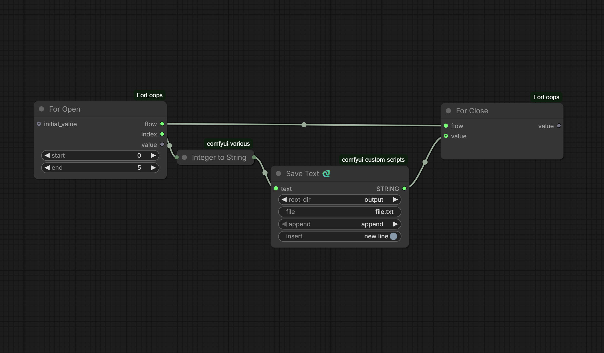
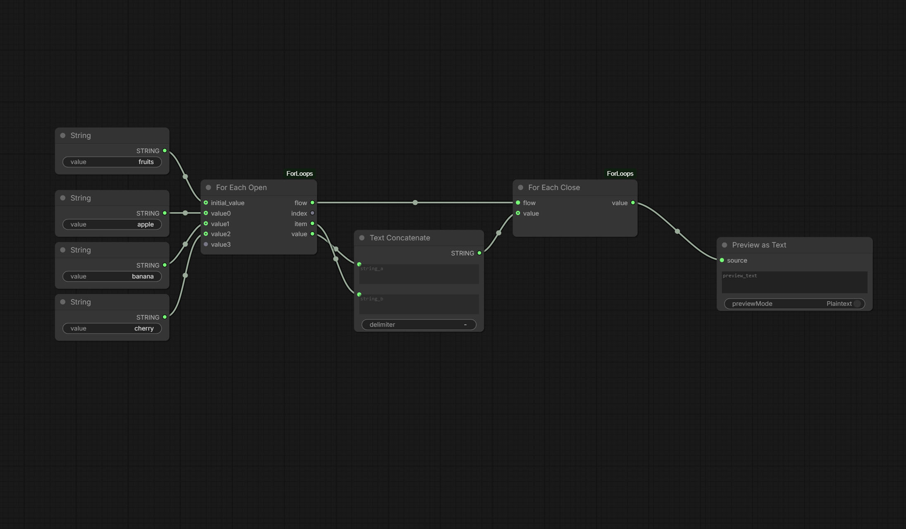

# JkNodes — ForLoop

🌐 [English](README.md) · **Português**

Loops reais dentro do grafo do ComfyUI, na categoria **JkNodes**.

Estes nós usam o modelo de execução por expansão de grafo do ComfyUI, então o
loop inteiro roda dentro de um único *Queue Prompt*. Todo loop é um par
**Open / Close**, e **tudo que estiver abaixo do nó Open (até o Close) é repetido
uma vez por iteração** — inclusive nós de saída como *Save Image* ou *Preview*.

---

## Nós

Os quatro nós ficam na categoria **JkNodes**.

### For Open / For Close
Um loop de contagem, igual ao `range(start, end)` do Python.

| Nó | Entradas | Saídas |
|----|----------|--------|
| **For Open** | `start`, `end`, `initial_value` *(opcional)* | `flow`, `index`, `value` |
| **For Close** | `flow`, `value` *(opcional)* | `value` |

- `index` emite `start, start+1, … , end-1` (ex.: `start=0, end=5` → `0,1,2,3,4`).
- `end` é **exclusivo**: o loop roda `end − start` vezes.

### For Each Open / For Each Close
Itera sobre até **50 entradas de qualquer tipo** (como um "switch any" tipado).
Conecte uma entrada e os sockets/saídas assumem esse tipo; um novo slot vazio é
adicionado automaticamente conforme você conecta mais.

| Nó | Entradas | Saídas |
|----|----------|--------|
| **For Each Open** | `value0 … value49` (dinâmico), `initial_value` *(opcional)* | `flow`, `index`, `item`, `value` |
| **For Each Close** | `flow`, `value` *(opcional)* | `value` |

- `item` é o elemento atual daquela iteração.
- `index` é a posição atual (começando em 0).

---

## Como ligar um loop


*For loop example*


*For Each loop example*


```
For Open ──flow─────────────────────────────► For Close
        └─index/item─► [ seu trabalho … → Save Image ]
```

1. Coloque um nó **… Open** e o **… Close** correspondente.
2. Conecte **Open `flow` → Close `flow`**.
3. Use o **Open `index`** (For) ou **Open `item`** (For Each) no seu pipeline.

Pronto. Tudo que estiver abaixo do nó Open roda uma vez por iteração, então um
*Save Image* no fim do pipeline dispara uma vez para cada iteração.

### Retornar um valor para o Close (opcional)
Você pode conectar o resultado do fim do seu pipeline na entrada **Close `value`**.
Isso é útil para:

- **Forçar a ordem** — garante que o pipeline inteiro termine (e salve a imagem)
  antes do loop avançar para a próxima iteração.
- **Acumular** — o `Close value` é devolvido ao **Open `initial_value`** na
  iteração seguinte, e o valor final sai pelo **Close `value`** quando o loop
  termina.

Configuração comum e robusta (recomendada — é a que você está usando):

```
Open flow  ──────────────► Close flow
Open index ──► [ carregar linha → gerar → Save Image ] ──► Close value
```

> **Open Flow → Close Flow**, **Open Index → índice da linha**, e depois de todo
> o processo (incluindo salvar a imagem) a saída volta para **Close Value**.

---

## Workflows de exemplo

Arraste um arquivo de [`example_workflows/`](example_workflows/) para o canvas do
ComfyUI:

- **For_example.json** — um loop `range(0, 5)`; o *Preview as Text* mostra o
  resultado.
- **ForEach_example.json** — itera sobre três strings e concatena tudo em uma só,
  mostrando como acumular ao longo dos itens.

---

## Observações e dicas

- **`end` é exclusivo.** Se o seu arquivo tem N linhas, use `end = N` para obter
  os índices `0 … N−1`. Se `end ≤ start`, o loop não itera.
- **O fio `flow` é tipado.** O `flow` de um *For* não pode ser ligado no Close de
  um *For Each* (e vice-versa) — isso é proposital, para evitar pares trocados.
- **O socket interno `_i` fica oculto** pelo JavaScript incluído; ele carrega o
  contador da iteração e é gerenciado automaticamente.
- Este pacote usa o mesmo mecanismo de execução dos exemplos oficiais de loop do
  ComfyUI (expansão de grafo via `comfy_execution.graph_utils.GraphBuilder`).

---

## Instalação

Coloque a pasta `ForLoops` em `ComfyUI/custom_nodes/` e reinicie o ComfyUI.
Não precisa de nenhuma dependência extra.
